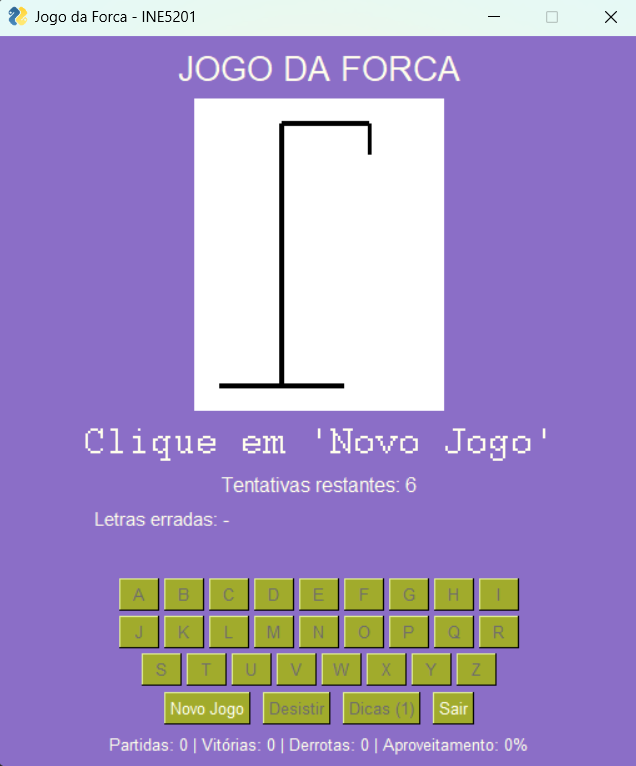
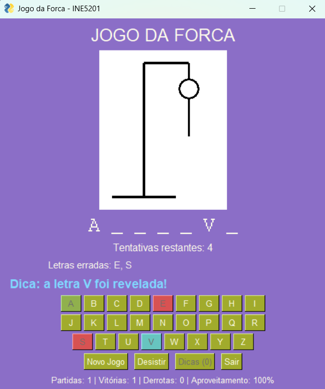
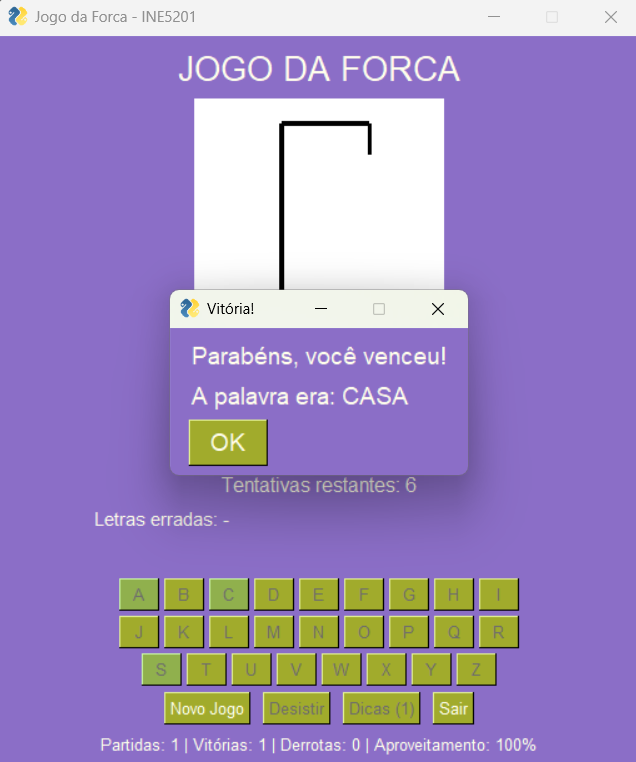
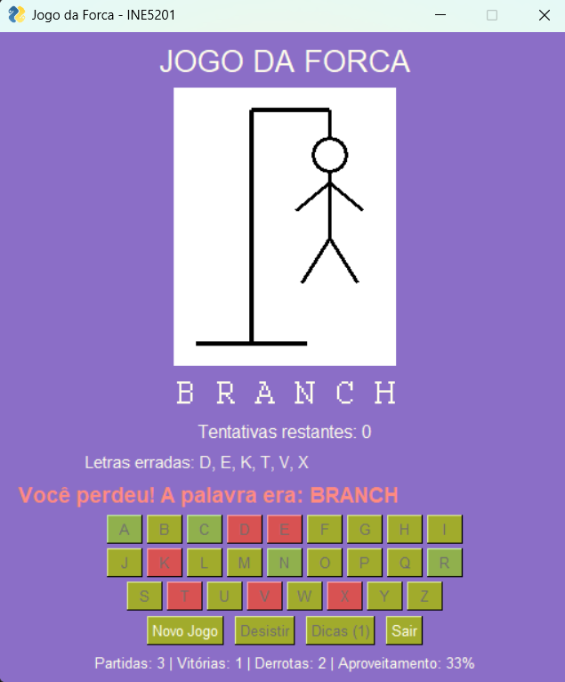
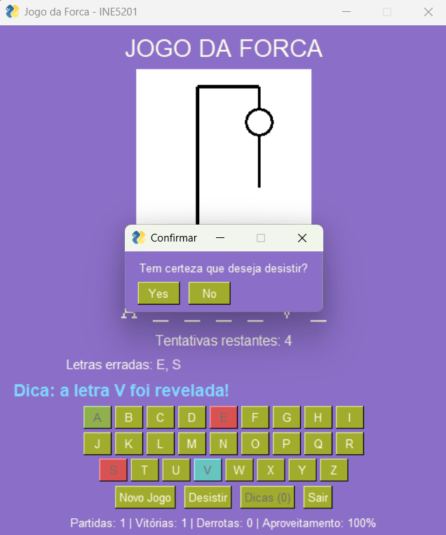
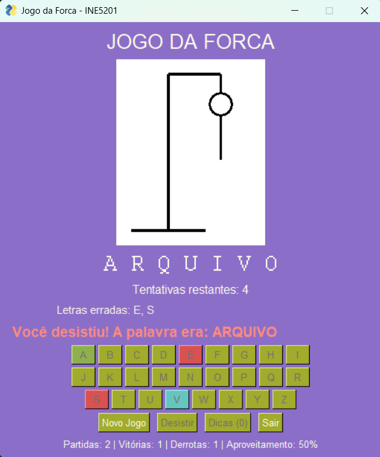
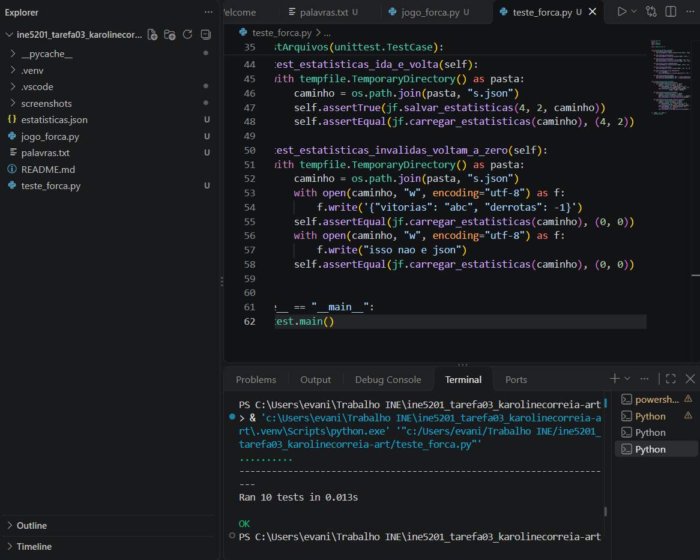

# Jogo da Forca com Interface Gráfica

*INE5201 - Introdução à Ciência da Computação com Python*
Universidade Federal de Santa Catarina (UFSC) | Prof. Rafael Novo da Rosa
*Tarefa 03* | Prazo: 24/11/2026

## Autoras

| Nome | GitHub |
|---|---|
| Karoline de Quadros Correia | [@karolinecorreia-art](https://github.com/karolinecorreia-art) |
| Letícia Olivo Colognese | [@leticiacolognese-max](https://github.com/leticiacolognese-max) |

## Sobre o projeto

Implementação do clássico *Jogo da Forca* em Python, com interface gráfica, leitura de palavras de um arquivo de texto e todas as regras tradicionais do jogo. O objetivo de aprendizagem da tarefa é aplicar manipulação de arquivos, strings, aleatoriedade e interface gráfica em um jogo completo.

## Requisitos da tarefa e onde foram atendidos

### Interface gráfica

| Requisito | Situação | Onde está |
|---|---|---|
| Display da palavra com letras ocultas (_ _ _ _) | Atendido | atualizar_display() |
| Teclado virtual com letras A-Z | Atendido | montar_layout() (26 botões em 3 linhas) |
| Boneco com 6 partes | Atendido | desenhar_boneco() (cabeça, tronco, 2 braços, 2 pernas) |
| Contador de tentativas restantes | Atendido | texto "Tentativas restantes" em atualizar_tela() |
| Mensagens de vitória e derrota | Atendido | vitória em janela separada (mostrar_vitoria()); derrota na tela principal (encerrar()) |
| Botões Novo Jogo, Desistir e Dicas | Atendido | montar_layout() e main() |

### Funcionalidades

| Requisito | Situação | Onde está |
|---|---|---|
| Leitura de palavras de arquivo .txt (mínimo 50) | Atendido (58 palavras) | carregar_palavras() e palavras.txt |
| Seleção aleatória de palavra | Atendido | escolher_palavra() (usa random) |
| Validação de letras já tentadas | Atendido | jogar_letra() |
| Contagem de erros (máximo 6) | Atendido | MAX_ERROS e jogar_letra() |
| Sistema de dicas (opcional) | Atendido | dar_dica() |
| Estatísticas de partidas (vitórias/derrotas) | Atendido | salvar_estatisticas(), carregar_estatisticas() e texto_estatisticas() |

### GitHub e Copilot

| Requisito | Situação |
|---|---|
| Repositório público no GitHub | Atendido |
| Mínimo de 5 commits distribuídos | Atendido (veja a aba *Commits* do repositório) |
| README.md completo | Este arquivo |
| Arquivo de palavras incluído no repositório | Atendido (palavras.txt) |

## Como o jogo funciona

1. Clique em *Novo Jogo*. O jogo sorteia uma palavra do arquivo palavras.txt, que aparece como traços (_ _ _ _).
2. Escolha letras clicando no teclado virtual ou usando o *teclado físico* do computador.
3. *Letra certa:* aparece nos lugares corretos e o botão fica verde.
4. *Letra errada:* o botão fica vermelho, o contador de tentativas diminui e uma parte do boneco é desenhada, na ordem: cabeça, tronco, braço esquerdo, braço direito, perna esquerda e perna direita.
5. *Vitória:* ao descobrir todas as letras, abre uma janela separada com a mensagem "Parabéns, você venceu!" e a palavra.
6. *Derrota:* com 6 erros, o boneco é completado e a tela mostra "Você perdeu!" com a palavra correta.
7. *Letra repetida:* o jogo avisa "Você já tentou 'X'!" e não conta erro.

### Botões

| Botão | O que faz |
|---|---|
| *Novo Jogo* | Inicia uma nova partida. Se houver uma partida em andamento, pede confirmação e a partida atual conta como derrota. |
| *Desistir* | Pede confirmação, revela a palavra e conta como derrota. |
| *Dicas (1)* | Revela uma letra ainda oculta (letra azul no teclado). Há *1 dica por partida* e ela *não* custa tentativa. |
| *Sair* | Fecha o jogo. |

### Estatísticas

O jogo mostra no rodapé: partidas jogadas, vitórias, derrotas e aproveitamento (%). Os valores são salvos no arquivo estatisticas.json, criado automaticamente na primeira partida finalizada, e continuam valendo ao fechar e abrir o jogo.

## Requisitos para executar

- *Python 3.10 ou superior*, com tkinter (já incluso na instalação padrão do Windows)
- *FreeSimpleGUI*, biblioteca gráfica com a mesma sintaxe do PySimpleGUI

> *Por que FreeSimpleGUI?* A tarefa cita PySimpleGUI, mas as versões novas dessa biblioteca passaram a exigir licença paga. O FreeSimpleGUI é um fork gratuito, compatível com a mesma API. Para usar o PySimpleGUI original, instale PySimpleGUI==4.60.5 e troque a linha de importação em jogo_forca.py por import PySimpleGUI as sg.

## Como instalar e executar

Clone o repositório e entre na pasta:

git clone https://github.com/karolinecorreia-art/tarefa03-karolinecorreia-art.git
cd tarefa03-karolinecorreia-art

### Windows (PowerShell)

python -m venv .venv
.\.venv\Scripts\python.exe -m pip install FreeSimpleGUI
.\.venv\Scripts\python.exe jogo_forca.py

### Linux ou macOS

python3 -m venv .venv
source .venv/bin/activate
pip install FreeSimpleGUI
python jogo_forca.py

## Testes automatizados

O projeto inclui 10 testes (test_forca.py) para as funções de lógica e de arquivos: remoção de acentos, display da palavra, verificação de vitória, letras ocultas e erradas, escolha de palavra sem repetição, estatísticas, carregamento de palavras e gravação e leitura do arquivo de estatísticas.

Para rodar (Windows):

.\.venv\Scripts\python.exe -m unittest test_forca -v

Resultado esperado: Ran 10 tests e OK.

## Estrutura do projeto

tarefa03-karolinecorreia-art/
├── jogo_forca.py        # Código do jogo e da interface gráfica
├── test_forca.py        # Testes automatizados
├── palavras.txt         # Banco de palavras (58 palavras, uma por linha)
├── estatisticas.json    # Vitórias e derrotas (gerado ao jogar)
├── screenshots/         # Capturas de tela do jogo
└── README.md            # Este arquivo

### Funções de jogo_forca.py

| Função | Responsabilidade |
|---|---|
| carregar_palavras(arquivo) | Lê o .txt, remove acentos, espaços, linhas vazias, duplicatas e palavras com caracteres fora de A-Z |
| escolher_palavra(lista, anterior) | Sorteia uma palavra, evitando repetir a da partida anterior |
| atualizar_display(palavra, letras_tentadas) | Monta a palavra com _ nas letras ocultas |
| desenhar_boneco(grafico, erros) | Desenha a forca e as partes do boneco conforme os erros |
| verificar_vitoria(palavra, letras_tentadas) | Informa se todas as letras foram descobertas |
| salvar_estatisticas(vitorias, derrotas) | Salva as estatísticas em JSON, com escrita segura e tratamento de erro |
| carregar_estatisticas() | Lê e valida as estatísticas; se o arquivo for inválido, zera |
| main() | Cria a janela e executa o loop de eventos da interface |

## Arquivo de palavras (palavras.txt)

Contém *58 palavras*, uma por linha, em minúsculas e sem acentos, com temas de programação, computação e engenharia. Exemplo:

python
casa
computador
universidade
programacao
algoritmo

Para adicionar palavras, escreva uma por linha. Acentos são removidos automaticamente na leitura, e linhas vazias, duplicatas e palavras com números ou símbolos são ignoradas.

## Uso do GitHub Copilot

O GitHub Copilot (extensão e Copilot Chat no VS Code) foi usado como ferramenta de apoio na revisão do código. Ele sugeriu melhorias, como validação das estatísticas, tratamento de erros ao salvar, testes automatizados, dicas mais previsíveis e recursos visuais. As sugestões foram avaliadas pela dupla e aplicadas de forma seletiva. Itens que aumentariam o risco de erros perto do prazo, como separar o estado em uma dataclass, ficaram de fora.

## Screenshots

### Tela inicial do jogo

### Jogo em andamento

### Vitória

### Derrota

### Confirmação de desistência

### Desistência

### Testes automatizados

## Organização do trabalho em dupla

O repositório foi desenvolvido pela dupla com colaboradoras no GitHub, usando git pull antes de cada alteração e git push ao final, com commits em diferentes momentos do desenvolvimento. Além do GitHub Copilot, utilizamos o Claude (Anthropic) como na configuração do VS Code, do Git e do GitHub, para a revisão do nosso código e também para entender quais dados precisam estar no README. 

## Licença e uso

Projeto acadêmico, desenvolvido para a disciplina INE5201 (UFSC).

